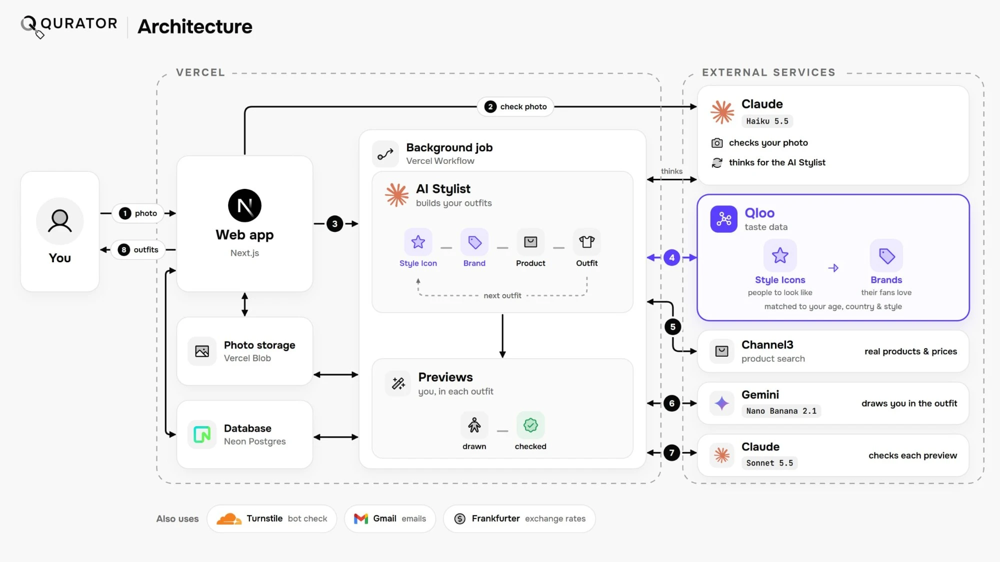

# Qurator: your style, curated by culture

Take one photo of yourself and get complete Outfits: a hairstyle, top, bottom and shoes, each inspired by a real Style Icon, built from real Products you can buy within your budget, and shown on you in an AI-generated Preview. Built for the Qloo Agentic Hackathon.

- **Live demo:** https://qloo-hackathon-kohl.vercel.app 
- **License:** [MIT](LICENSE)



## The problem

Have you ever wanted to change your style but had no idea where to start? There are thousands of brands, endless haircuts, a new style icon every week, and trends that disappear within a month. Finding what suits you is like looking for a needle in a haystack.

Research shows 82% of the clothes in people's wardrobes go completely unworn for at least 12 months and 74% of online shoppers abandon their carts simply because they feel overwhelmed by the choices. Additionally, Millennials and Gen Z report the highest rates of clothing indecision. Constant exposure to social media and hyper-fast trend cycles forces them into a daily balancing act between personal taste and online influence, making outfit selection much harder.

Most style apps answer this with a generic AI that guesses what looks good, so they give everyone the same "smart casual" advice. We wanted recommendations grounded in what real people, in your age group and your country, actually love.

## What Qurator does

Qurator is an AI stylist. Take one photo of yourself and it builds complete Outfits: a hairstyle, a top, a bottom and shoes. Each Outfit is inspired by a real Style Icon, made from real Products you can buy within your budget, and shown on you in an AI-generated Preview.

## Why Qurator doesn't work without Qloo

**Qloo decides which Style Icons and Brands can be recommended, and in what order. Our AI Stylist only chooses among Qloo's picks and turns them into real Products.** Qloo has no garment or haircut entities. Fashion only exists there as brands, and style only exists as people. So we built the whole pipeline around Qloo's taste graph:

1. **Choosing Style Icons.** We call Qloo's `/v2/insights` with `filter.type=urn:entity:person`.
   - Signals: the user's age bracket, the menswear or womenswear line, their Country, and a Photo Style. The Photo Style is one or two of Qloo's own `personal_style` tags, such as _edgy_ or _classic_, which Claude reads from the photo.
   - Filters: occupation tags (models, singers, actors, athletes and so on), excluded tags for people who aren't famous for their look, and a high popularity floor.
   - Qloo ranks the results by affinity, and the Stylist works through them in that order.
2. **Choosing Brands.** For each Style Icon, we make a second `/v2/insights` call with `filter.type=urn:entity:brand`. The Style Icon goes in as `signal.interests.entities`, so Qloo returns the brands that icon's fans favour, for the same age, line and Country.
   - Qloo's own tags filter the brands: `genre:brand:fashion`, `target_age_group` so brands are age-appropriate, and `key_market` for the user's Country.
   - The Budget Tier also uses Qloo's tags: `target_income_level` plus a check on Qloo's `price_range_usd`.
   - Qloo's `product_category` tags decide which brands can supply the Top, the Bottom and the Shoes.
   - When too few usable brands come back, the query widens one step at a time.
3. **The AI Stylist chooses among Qloo's picks.** Each Styling is run by an AI agent (Claude Haiku 5.5) that works through tools in a loop: `findStyleIcons`, `fetchBrands`, `searchProducts`, `passOverStyleIcon`, `saveOutfit`, `writeNote` and `finish`.
   - It takes Style Icons in Qloo's order. It may pass over one whose style clashes with the photo, or, on a Face Photo, one whose signature cut needs much longer hair than the user has. It says why in a note.
   - For each Category it picks one of that Style Icon's **top 3 Qloo Brands**, such as the Shoes Brand that sells trainers for a _sporty_ Photo Style. It explains whenever it doesn't take the first.
   - The tools, not the model, enforce the rules. They refuse any Style Icon or Brand Qloo didn't return, and they keep the Budget Tier, the Country, each Brand's price range, stock, our denylists, and the rule that no Brand repeats across Outfits.
4. **Making it real.** For each Brand the Stylist takes, we search for Products from that Brand within its Qloo price range. The Stylist picks the Product that best suits the user and the rest of the Outfit, and writes why. It also adapts the Style Icon's signature cut into a hairstyle the user's own hair can achieve. Gemini then draws a Preview of the user wearing the Outfit. Claude Sonnet checks it and has it redrawn once if it's wrong.

**The Stylist never uses a Style Icon or Brand that Qloo didn't return, and never writes its own Qloo queries.** Two users with different ages, Countries or Photo Styles get different candidates. Without Qloo, the Stylist has nothing to choose from.

**Why `/v2/insights`:** it's the one endpoint that combines demographic, location, tag and entity signals with tag filters and affinity ranking. We use it for both questions: who you could look like, and what those people's fans wear.

## How it works

1. Create an account with your date of birth (adults only), your Style Preference (menswear, womenswear or no preference) and your Country, then verify your email.
2. Agree to the photo consent notice.
3. Upload or take a photo. A Face Photo gets hairstyles, a Full-Body Photo gets the whole Outfit, and a Body-Only Photo, without your face, gets the clothes and shoes. Claude checks the photo and reads its Photo Style. Other people can be in the photo, but only the clear main person is styled. Everyone else is left as they are.
4. Pick a Budget Tier: No Budget, Low, Medium or Expensive. Face Photos skip this.
5. Watch the Stylist work. A checklist ticks through _Checking your photo_, _Finding Style Icons_, _Building Outfits_ and _Generating Previews_. Under it, the **Stylist's Notes** show what it's doing and why: which Style Icon it's building from, why it chose a Brand or Product, each product search, and each Preview it draws.
6. Get your Outfits. Each one shows its Style Icon, every Piece with the reason it suits you, a price in your own currency, and a link to buy it. The Stylist's Notes stay underneath.
7. Want more? Press **"Show 2 more Outfits"**. You can also change your Photo Style or Budget Tier to get different Style Icons and Brands.

## How we built it

- **Stack:** Next.js on Vercel, Neon Postgres, Vercel Blob storage and Better Auth. Each Styling runs as a Vercel Workflow, so every model call and tool call is a durable step that survives a restart.
- **Qloo** is called only from our server. The API key never reaches the browser.
- **AI models**, all behind our own interface so any of them can be swapped:
  - **Claude Haiku 5.5** checks each photo and reads its Photo Style.
  - **Claude Haiku 5.5** also runs the AI Stylist, using the AI SDK's Workflow agent.
  - **Gemini Nano Banana 2.1** draws each Preview from the user's photo and the sellers' product images.
  - **Claude Sonnet 5.5** checks each Preview for the wrong garment, a changed face, or a face invented on a Body-Only Photo. A faulty Preview is redrawn once with Sonnet's correction, and our code, not a model, decides which image to keep.
  - Users see the Stylist's notes and tool calls, never its internal reasoning.
- **Channel3** provides the product search.
- **Testing:** an automated test suite with fake Qloo, Claude, Gemini and Channel3 clients, so no test spends real API calls. A separate Stylist check (`npm run check:stylist`) runs the real Stylist on fixed photos to measure quality and cost.
- **Privacy by design:** we never send Qloo anything that identifies a person. It only ever gets an age bracket, a line, a Country, style words and Qloo entity IDs. Photos go only to Anthropic and Google, to check and edit them. They're never analysed for identity, ethnicity, skin tone or body shape. Users can delete any Consultation or their whole account.
- The whole project was built during the hackathon.

### API rate limiting and cost control

- **Qloo:** responses are cached for 30 days. A `429` gets a bounded back-off that follows Qloo's `Retry-After` header. We also track Qloo's monthly quota header and stop starting new Stylings before the quota runs out.
- **Usage caps:** per Styling (agent turns, Qloo calls and product searches), per user (10 Outfits a day) and app-wide (750 Outfits a month).
- **Abuse protection:** per-IP sign-in and sign-up limits, a bot check, and caps on emails sent.

## Limitations

**What the results do and don't mean**

- Results show **aggregate taste**: what people in your age bracket, line and Country tend to like, according to Qloo's data. They don't predict what _you_ will like.
- A Style Icon's Brands are the brands **their fans favour** on Qloo. That doesn't mean the Style Icon wears, endorses or is linked to those brands.
- Qloo decides which Style Icons and Brands are candidates, and in what order. From Qloo's top picks, the Stylist chooses the ones that best suit the user's photo, Photo Style and the rest of the Outfit, always within the user's own filters: Budget Tier, Country, age group and menswear or womenswear. That choice is an AI's judgement of fit, so the Stylist's Notes explain its reasoning but aren't Qloo data.
- A hairstyle is _inspired by_ the Style Icon's signature cut and adapted to your hair. It isn't a copy of their actual haircut. When the Stylist doesn't know the cut, the Outfit says so.
- Previews are AI images that show roughly how an Outfit could look. They aren't a fit or sizing guarantee.

**Limits of Qloo's data**

- Qloo has no garment or haircut data, so the specific Products come from a product search, not from Qloo.
- Budget Tiers are based on Qloo's brand-level income tags and USD price ranges, which are only a proxy for real prices. A Low Brand can still sell an expensive item. We keep each Product within its Brand's Qloo price range to limit this.
- Qloo's product tags are coarse. Denim is the only signal for a brand that makes bottoms.
- The high popularity floor makes the recommendations lean towards mainstream brands and famous people. Niche and independent labels rarely appear.
- The Photo Style comes from a fixed list of 11 Qloo style words, so subtler styles get flattened into the closest word.

**Product and pricing limits**

- The product search covers 20 countries. Other euro countries use its EU market, and every other Country, including Singapore, uses its US market, so some Products may not ship to you. Prices are converted to your currency.
- Some Brands Qloo picks can't be found in the product search, so they're skipped. That can leave fewer Brands for some Countries.
- Prices and stock come from sellers. Converted prices are approximate, they refresh at most once a day, and a Product can sell out.

**Deliberate design choices**

- We don't analyse skin tone or body shape, so there's no colour-season or body-type advice. Users get privacy and less personalisation.
- Adults only, because of Gemini's terms. Only Countries where Gemini is available. English only.
- Each Styling makes up to 2 Outfits, with a limit of 10 Outfits per user per day to control costs.
- Servers run in Washington DC, so users in Asia will see slightly slower page loads.

## Run it locally

Needs Node.js 22 or later and your own Qloo hackathon API key.

```bash
npm install
cp .env.example .env.local   # then set QLOO_API_URL and QLOO_API_KEY
npm run dev
```

Out of the box, local development uses an on-disk database, a fake AI and a fake product search, so only Qloo is real. Emails are written to `.data/inbox` instead of being sent, so open the verification link from there. To use real Gemini or Channel3, see [.env.example](.env.example).

Tests: `npm test`, `npm run typecheck` and `npm run test:e2e`. The team's operations guide (Demo Account, daily sweep, team scripts) is in [docs/operations.md](docs/operations.md).

## Credits

The people in the landing page's sample Consultations are AI-generated images from [Pixabay](https://pixabay.com), used under the Pixabay Content License.
